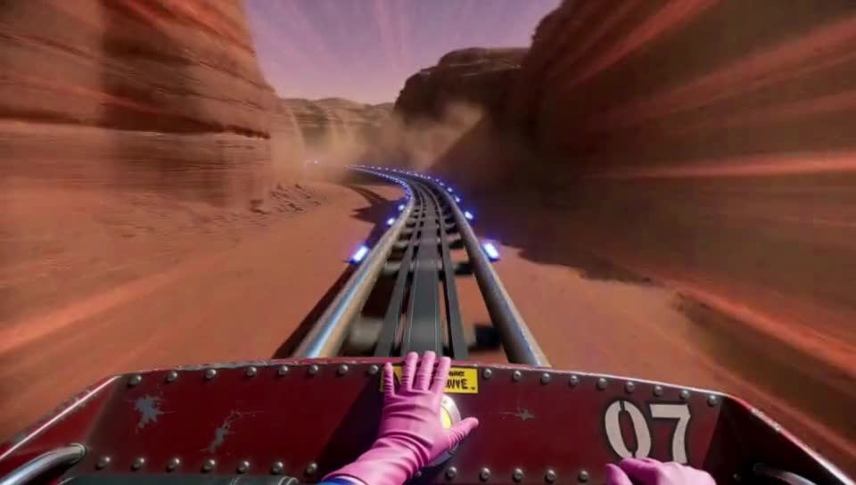

# Geiru Context Suite

ComfyUI nodes for chaining MiniMax H3 clips without the quality slowly falling apart.

> **New name.** This used to be the **Clown Context Suite**. ClownsharkBatwing's [RES4LYF](https://github.com/ClownsharkBatwing/RES4LYF) nodes are already called Clown-everything, and they're some of the most widely used nodes in ComfyUI, so to avoid mix-ups the suite is now named after the clown herself: **Geiru**. Only the names you see changed. The internal node names (`H3Clown...`) are the same, so workflows saved with the old names still load.

## Credits

The Geiru Context Suite stands on other people's work. I'm building off it, so all credit to them:

- **seitanism**: [ComfyUI-H3-Motion-Context-MultiRef](https://github.com/seitanism/ComfyUI-H3-Motion-Context-MultiRef). Holding the previous shot's real latents at the start of the next one, masked, is his method; Geiru Context is built on it.
- **NikoDemon80**: [ComfyUI-H3-Motion-Context](https://github.com/NikoDemon80/ComfyUI-H3-Motion-Context), the Chain node (copied in unchanged apart from its name as [Geiru Chain](#geiru-chain), GPL-3.0 like this pack), and months of drift measurements that shaped how this was tested.
- **ethanfel (Lumifel)**: the context noise idea behind **Geiru Context Noise** (see [ComfyUI-MiniMaxH3-Context-Loop](https://github.com/ethanfel/ComfyUI-MiniMaxH3-Context-Loop)), and [ComfyUI-H3-Prompt-IDE](https://github.com/ethanfel/ComfyUI-H3-Prompt-IDE).
- **drozbay** ([GitHub](https://github.com/drozbay)): native H3 latent-mask support and the masked-extension method everything here relies on, from [MaskVidExperiments](https://github.com/drozbay/MaskVidExperiments).
- **kijai** ([GitHub](https://github.com/kijai)): ComfyUI's MiniMax H3 support and the H3 context windows ([PR #17425](https://github.com/Comfy-Org/ComfyUI/pull/17425)) that Geiru Hybrid Windows is built on, plus [ComfyUI-KJNodes](https://github.com/kijai/ComfyUI-KJNodes).
- **JalenBrunson**: [ComfyUI-HybridWindows](https://github.com/Jalen-Brunson/ComfyUI-HybridWindows), which Geiru Hybrid Windows works like. I just added the keystone and capstone to it.
- **TrentHunter82**: [TrentNodes](https://github.com/TrentHunter82/TrentNodes). Its degrade node made the bad frame 0 tests possible, which showed how much a clean frame 0 matters (the idea behind Geiru Keystone).
- **Imagineer13**: the [H3 Anti-Burn LoRA](https://huggingface.co/Imagineer13/H3-Anti-Burn-LoRA) (training code on [GitHub](https://github.com/TryingSomeStuff13/ai-toolkit/tree/h3-antiburn/extensions_built_in/diffusion_models/minimax_h3/antiburn)), used in the experimental [Geiru Protection LoRA](https://github.com/roycho87/Geiru-Protection-LoRa-Experimental). Not part of this pack.
- Everyone on the Banodoco Discord and r/StableDiffusion who tested, argued and shared results.

## The problem

When you chain H3 clips, each new clip starts from the tail of the last one. You tell the model where to start, but never where to end. Detail is lost a little in every clip, and because each clip starts from the one before, the loss stacks up over the chain.

## The fix: pull every shot back to clip 1

**Geiru Context** pins the previous shot's tail to the front of each shot, so the motion carries over. **Geiru Keystone** locks clip 1's first frame into the start of every shot and tacks clip 1's capstone onto the back, and **Geiru Late Lock** brings the capstone in only for the last steps, so the shot picks its own pose first. Every shot is pulled back toward how clip 1 looked, so the loss can't stack up. With Geiru Context in front of Keystone the real frames are put back afterwards, so nothing from clip 1 ends up in the clips.

It's the simplest way to run a long chain: no language model and no extra renders. Start with the [Mad Clown Inventor example](#mad-clown-inventor-example).

## Degradation protection (one switch)

Four nodes keep a long chain from drifting. Each keeps its own node and settings:

| Node | What it does |
|---|---|
| **Geiru Keystone** | Locks the source clip's clean first frame (keystone) into the start of every shot and/or tacks its capstone onto the back. |
| **Geiru Late Lock** | Brings Keystone's latents in only from a chosen step, so the shot picks its own pose first. |
| **Geiru Context Noise** | ethanfel's context noise: the held frames get some of the sampler's current noise, fading to none at the join, so H3 doesn't copy them so exactly. |

**Geiru Context**'s `degradation_protection` switch turns them all on or off together:

- **On** (default): each runs with its own settings. If you've turned one off on its own node, it stays off.
- **Off**: they all pass through, as if they weren't there.

Set them up once, then flip one switch: on for long stretches of one continuous scene, off around cuts and scene changes. In testing, a hard cut or a new environment already resets the drift on its own, so protection is only needed while the scene stays the same. When the scene changes, point Keystone's `source_clip` at the first clip that fully shows the new scene (not the transition clip).

**Wiring:** Geiru Context → Geiru Context Noise → (Geiru Anchoring) → Geiru Keystone → Geiru Late Lock → sampler, with the model plugged through Context Noise, Keystone and Late Lock.

**With Geiru Anchoring:** Anchoring holds frames at the end of the shot, which is where the capstone would go. So when Anchoring is holding something, Keystone and Late Lock skip the capstone automatically (the keystone at the front is still used). Nothing to set.

### Geiru Protection LoRA moved to an experimental repo

Geiru Protection LoRA (a LoRA loader that only runs while protection is on, made for Imagineer13's [H3 Anti-Burn LoRA](https://huggingface.co/Imagineer13/H3-Anti-Burn-LoRA)) is now in its own repo: [Geiru-Protection-LoRa-Experimental](https://github.com/roycho87/Geiru-Protection-LoRa-Experimental). The early tests showed a colour improvement, but later tests weren't able to replicate it; the suspected cause is double compression of one of the initial test's side-by-side videos during stitching. I (roycho) tested the LoRA previously on its own, without these nodes, and it had a positive impact on colour; these tests just couldn't show any extra colour gain on top of degradation protection. They did show it doesn't hurt fine detail. Please try it and share what you find; more testing is needed. I plan to explore using a LoRA with this loader, on top of my protection nodes, to preserve colour better. The Clown in Imagination Land example moved there too.

### Your speed (turbo) LoRA matters

Certain LoRAs affect degradation protection differently, because a LoRA changes how the model reacts to noise. The noise itself is the same (it comes from the scheduler), but each turbo was trained on its own noise levels, so it can handle the partly-noised held frames very differently.

All of my testing used `minimax_h3_ref2v_turbo_8step_v1.0_768p_comfyui_resized_avg_rank_64_bf16`. Etupa (thanks for testing!) still got degradation with `minimax_h3_ref2v_turbo_silver_dareties_comfy_pruned_v2`, even with context noise at 1, and none with the 8-step turbo above (704 × 1280, 3 clips of 8 s). If you see degradation with a different turbo, try that one. I'll be testing other speed LoRAs and higher resolutions next.

### Results

On a walking scene, keystone + capstone + context noise held for 20 clips (about 2½ minutes) with no build-up; on a 50-clip chain through four scenes, it held where the plain chain fell apart (below). On a fully locked-off static shot the texture holds, but the colour can still slowly darken. Full numbers: [NerdNotes](https://github.com/roycho87/NerdNotes).

## The 50-clip test

One 50-clip chain (8-second clips, about 5 minutes 20 seconds stitched), rendered twice with the same prompts, seed and settings: once with degradation protection on, once as a plain chain. It runs through four scenes:

| Clips | Scene | Protection |
|---|---|---|
| 1–20 | Running along a beach, camera tracking | Keystone + capstone from clip 1, context noise |
| 21–22 | Slows down and sits at a beach café | Keystone off, context noise on |
| 23–30 | Sitting at the café, still camera | Keystone + capstone from clip 22 |
| 31–40 | Walking through a changing town | Keystone off, context noise on |
| 41–42 | Sits down on a garden sofa | Keystone off, context noise on |
| 43–50 | Sitting in the garden, still camera | Keystone + capstone from clip 42 |

The end of each section (protection on, top; plain chain, bottom):


- **Beach:** by clip 20 the plain chain has fallen apart (glitchy sky, burnt skin, the sand more than twice as gritty). With protection it's still clean, though about 12 levels darker than clip 1.
- **Café and garden:** with protection there's barely any drift (the garden stays flat for 8 clips); the plain chain keeps getting darker.
- **Scene changes reset the drift on their own,** which is why protection is a switch: on for long single-scene stretches, off around cuts.

Full numbers, every clip of both chains, and how it was measured: [NerdNotes, section 10](https://github.com/roycho87/NerdNotes/blob/main/20261101/frame0_conclusions.md#10-beach-benchmark-a-50-clip-chain-through-four-scenes).

## Geiru Prophecy has moved

Geiru Prophecy (with Clown Carryover and the Prophecy example workflows) now lives in its own repo: [Geiru-Prophecy-Experimental-](https://github.com/roycho87/Geiru-Prophecy-Experimental-). It's too inconsistent and experimental to be considered a finished node. Keystone and Capstone are a much more promising direction.

## Nodes

Everything shows up under the **Geiru Context Suite** category.

| Node | What it does |
|---|---|
| **Geiru Context** | Holds the previous shot's last frames (and audio) at the start of this shot. Has the `degradation_protection` switch. |
| **Geiru Anchoring** | Holds a source's frames (and audio) at the end of this shot. Plug any source into `next_shot`, e.g. an ending from Geiru Prophecy. |
| **Geiru Shot Counter** | The shot number, plus `previous_shot` and `continuation` (true from shot 2 on). Can also follow the H3 Motion Context Chain node's count. |
| **Geiru Chain** | nikodemon's Motion Context Chain node, renamed: Approve, Run/Re-roll, Chain, Reset and Clear buttons that drive the Load / Save Latent shot numbers. |
| **Geiru Keystone** | Puts clip 1's first frame (keystone) into every shot and/or tacks its capstone onto the back. With Geiru Context in front of it, puts the real frame back afterwards. |
| **Geiru Late Lock** | Picks the step Keystone's latents come in, so the shot picks its own pose first. |
| **Geiru Context Noise** | ethanfel's context noise on the held frames. The real held latents are put back after sampling. |
| **Geiru Hybrid Windows** | One long render (a minute or more) in overlapping windows instead of a chain of clips, with clip 1's keystone and capstone in every window. |

## Geiru Shot Counter

| Setting | Meaning |
|---|---|
| `use_classic_counter` on | The `shot_number` box is the shot. `increment` / `decrement` change it each time you hit run, `increment after accept` only after an accepted run of Geiru Prophecy (one shot at a time only), `fixed` never. `follow motion context` copies the `clip_index` from Motion Context's Save Latent node each run (see [Using it with a Chain node](#using-it-with-a-chain-node)). |
| `use_classic_counter` off | The shot is worked out when the run starts: highest saved latent in `latent_prefix` + 1. Each new chain needs its own empty folder. |
| `latent_prefix` | The Save Latent `filename_prefix` (count mode). |

The box at the bottom of the node shows the shot the last run used, and in count mode how many latents are saved and which shot is next.

## Geiru Chain

A renamed copy of the Chain node from nikodemon's [ComfyUI-H3-Motion-Context](https://github.com/NikoDemon80/ComfyUI-H3-Motion-Context). It's here because Motion Context and seitanism's [MultiRef](https://github.com/seitanism/ComfyUI-H3-Motion-Context-MultiRef) use the same node names, so you can only have one installed, and MultiRef has no Chain node. With Geiru Chain you can use either pack.

It works exactly like the original. Keep **Load Latent**, **Save Latent** and **Geiru Chain** in the same canvas group. Either pack's Load / Save Latent nodes work. If you have Motion Context installed you can use its own Chain node instead; everything works the same.

| Button | What it does |
|---|---|
| **Approve** | Moves Load and Save up one and runs the next shot. |
| **Run/Re-roll** | Runs the current shot again. Use this instead of ComfyUI's Run button. |
| **Chain** | Approve on a loop. `segments` = how many shots before it stops (0 = until you press Stop). |
| **Reset** | Sets Load 0 / Save 1. Doesn't delete anything. |
| **Clear latents** | Deletes the numbered saved shots in the Load folder. Custom file names are kept. |

On the first shot Geiru Context doesn't run the Load Latent node at all, so MultiRef's Load (which errors on an empty folder at `clip_index` 0) is fine.

### Using it with a Chain node

Set the counter's `shot_counter` to **follow motion context**. The counter then copies the `clip_index` from the Motion Context **Save Latent** node every run, so the shot number lines up with the Chain node's count. The counter only reads that number and never changes it; the Chain node stays in charge. Leave Load and Save Latent's `clip_index` as widgets (not wired) so the Chain buttons can move them.

## Geiru Context and Geiru Anchoring

Both copy real latents into the shot at matching block positions and mask them so the sampler keeps them. Frame counts go 5, 22, 39, 56, 73… (17n + 5); the drop settings go in steps of 17.

- `head_frames` (Context) is the overlap with the previous shot. If you use pre-split audio, set it to the audio overlap (e.g. 39).
- `drop_last` / `drop_first` trim the held frames from either end.
- `hold_audio` holds the previous shot's audio for the whole overlap (all `head_frames`), even where `drop_last` / `drop_first` free the picture: the model makes those frames fit the held sound. `audio_drop_last` trims held audio off the end so the new shot's own sound comes in sooner (0 = hold it all). `audio_feather_ticks` fades the held audio out at the join instead of a hard cut. Geiru Anchoring works the same way at the end of the shot, with `audio_drop_first` trimming held audio off the front.
- `shot_number` (optional, from the Geiru Shot Counter): on the first shot they don't load their source at all and pass the latent through. Handy when Anchoring's `next_shot` comes from a Load Latent of a clip that isn't made yet. Leave it unplugged and they work as before.

**Recommended settings** (the Anchoring frames must outnumber the Context frames):

| Node | Frames | Drop |
|---|---|---|
| **Geiru Context** | `head_frames` 39 | `drop_last` 17 |
| **Geiru Anchoring** | `tail_frames` 56 | `drop_first` 17 |

**Workflows that use Geiru Anchoring** (in [Geiru-Prophecy-Experimental-](https://github.com/roycho87/Geiru-Prophecy-Experimental-)):

- [sane_person_example.json](https://github.com/roycho87/Geiru-Prophecy-Experimental-/blob/main/example_workflows/sane_person_example.json): Geiru Chain + Prophecy + Anchoring.
- [sane_clown_example.json](https://github.com/roycho87/Geiru-Prophecy-Experimental-/blob/main/example_workflows/sane_clown_example.json): the same, with Clown Carryover.
- [insane_example.json](https://github.com/roycho87/Geiru-Prophecy-Experimental-/blob/main/example_workflows/insane_example.json): the vlog, pre-split audio and one prompt file per shot.

Two more are in this repo's `example_workflows` (moved over from my old packs and switched to Geiru Context and Geiru Anchoring, same settings):

- [everyone_wants_a_piece_of_the_clown.json](example_workflows/everyone_wants_a_piece_of_the_clown.json): a Motion Context chain with Geiru Context (39, drop_first 17) and Geiru Anchoring (39, drop_last 17).
- [withers_has_big_nattys.json](example_workflows/withers_has_big_nattys.json): the static vlog (odd shots fresh, even shots continue). On even shots, Geiru Context (39, drop_first 17) holds the end of the shot before at the start, and Geiru Anchoring (39, drop_last 17) holds the start of the shot after at the end. Motion Context's Load / Save Latent nodes are still used for the clips.

### Joining the clips

Each clip is saved whole (all of its frames, overlap included), so trim them when you join them. `drop_last` doesn't remove the overlap, it only changes what's in it. With Geiru Context at 39, `drop_last` 17:

- The new shot's frames 0-21 are exact copies of the previous shot's frames 153-174 (the held part).
- The new shot's frames 22-38 are freshly made, but they cover the same moment as the previous shot's frames 175-191 (the dropped part).

So the two clips still share 39 frames of time: 22 identical, and 17 that are two different takes of the same moment. Butted together untrimmed, that moment plays twice. Cut so the join lands inside the identical part, then it's seamless:

1. **Cut the last 39 frames off every clip except the last one** (the default). The previous clip ends on frame 152 and the next one starts on its frame 0, which is an exact copy of frame 153.
2. **Cut the last 17 frames off each clip and the first 22 off the next.** The previous clip ends on frame 174 and the next one carries on from its frame 22. Use this if the start of each clip has something you don't want to keep.

Don't cut the first 39 frames off the next clip instead: that joins two different takes of the same moment and can show a small jump. The last clip is always kept whole. For other settings, the overlap is `head_frames` and the identical part is `head_frames` minus the drops.

**[Seamless Video Combiner](https://github.com/roycho87/workflows/blob/main/workflows/seamless_video_combiner/clussy_origin_story.json)** (in my workflows repo) does the join for you, sound included (with a short audio crossfade at each seam). `example_workflows/sane_clown_combiner.json` is set up for Geiru chains: 10 clips, 8 seconds (192 frames) each, overlap 39, cutting the end of each clip (End pair: End Overlap 39, End Join 0). For way 2, turn on **Use Beginning pair** (Beginning Overlap 39, Beginning Join 22). Copy the clips from `output/h3_ref2va/` into ComfyUI's `input` folder (or pick them in the ten Load Video nodes), set the number of videos and the duration if yours differ, and run.

## Geiru Keystone and Geiru Late Lock

- **keystone** = clip 1's first frame (frame 0).
- **capstone** = a frame from the end of clip 1 (frame 187 of a 192-frame clip).

**Why clip 1:** in a chain, each later clip's frame 0 comes from the previous clip's tail. That frame was made in the middle of the previous clip, so it already carries everything that drifted on the way there, and it gets copied forward again and again. Clip 1's frame 0 is the only one from before any drift, and the first frame is what MiniMax leans on most.

**source_clip:** you can switch to a different source clip at any point. If the scene changes, set `source_clip` to a newer clip, and that clip's keystone and capstone are used from then on. Shots up to and including the source clip pass through untouched.

- **Front:** the keystone (or capstone) is locked into the shot's latent 0. With **Geiru Context** before Keystone, latent 0 is a real frame held from the previous shot, and it's put back after sampling, so the saved latent and the video keep the real frame. Without Geiru Context (for example plain Motion Context), there's no real latent 0 to put back, so each clip's first frame stays clip 1's frame: it still works as a detail anchor, just trim that one frame when you join.
- **Back:** nothing in the shot is replaced. The latent is tacked on after the shot's last latent for each model call (locked) and cut off again, so it's never in the output.

Putting the frame back and the back placement both need the model, so plug the model through Keystone (model in, model out to the guider) or use Geiru Late Lock.

| Setting | Meaning |
|---|---|
| `enabled` | On / off. |
| `placement` | `keystone front` (default), `keystone front + back`, `capstone front + back`, `keystone front + capstone back`. front = written into the shot's first latent, back = tacked on after the shot's end. |
| `source_clip` | The clip the keystone and capstone come from (1 by default). With `latent_folder` set, this is the only number you change. With `shot_number` plugged in, shots up to and including this clip pass through. |
| `latent_folder` | The folder your chain saves its latents in (your Save Latent's folder, e.g. `h3_ref2va`). When set, Keystone loads `source_clip` from it itself and the source clip input isn't needed. Leave it empty to use the source clip input instead (then set that Load Latent to the same clip as `source_clip`, since it's what actually picks the latent). Needs H3 Motion Context or Motion Context MultiRef installed. |

| Input | Meaning |
|---|---|
| `source clip (keystone / capstone)` | A Load Latent fixed on the source clip. Keep it **outside** the Chain group so the Chain buttons don't change its number. |
| `model` | Optional. Plug it through here (model out to the guider) if you don't use Late Lock: then the back is tacked on from step 1 and latent 0 is restored. |
| `shot_number` | From Geiru Shot Counter. On the source clip's shot and earlier nothing is grafted (the source clip doesn't exist yet). |

**Geiru Late Lock** goes between Keystone and the sampler: latent from Keystone in, latent out to the sampler; model in, model out to the guider. A capstone locked from the start pulls the pose back toward clip 1; Late Lock avoids that. `swap_step` is when Keystone's latents come in:

- **Capstone (back):** nothing is there for the first `swap_step` steps, then it's tacked onto the back for the rest, so nothing pulls on her motion and pose while the shot decides them.
- **Keystone (front):** the slot is held empty (left as noise the model doesn't change) for the first `swap_step` steps, then locked in.

`slots` picks which: `capstone slot (back)` (default), `keystone slot (front)`, or both. It only touches what Keystone set up, so on shot 1 it does nothing. Late Lock also puts the real frame back, so you don't need the model through Keystone as well.

**Setting `swap_step`:** the default is 4. It's recommended to set it to the last 25% of your steps (for example 6 on an 8-step run). The best point depends on your scheduler and sampler, since it's really the noise level that decides when Late Lock works best. Raise it if it starts to affect motion; lower it if colour or detail starts to go.

Comparison, clip 10 of the same 10-clip chain: no Keystone (base), keystone front, and keystone front + Late Lock capstone.

https://github.com/user-attachments/assets/3002019d-7d6d-4afc-9592-09a3c201fb78

In a 10-clip test (measured about 20 frames from the end of clip 10), colour drift from clip 1 went from 6.4 with no Keystone, to 3.9 with keystone front, to 2.9 with keystone front + Late Lock capstone. Over-sharpening dropped as well. (That test used the earlier version, which wrote the capstone into the shot's last single-frame slot instead of tacking it on.)

**Joining:** with Geiru Context in front of Keystone and the model plugged through Keystone or Late Lock, nothing from clip 1 ends up in the saved clips, so join them the normal way (cut the last 39 frames of each clip). Without the model, or without Geiru Context, latent 0 stays clip 1's frame, so use the 17 + 22 cut instead (Seamless Video Combiner: **Use Beginning pair** on, Beginning Overlap 39, Beginning Join 22).

## Geiru Hybrid Windows

Built on **kijai**'s MiniMax H3 context windows ([PR #17425](https://github.com/Comfy-Org/ComfyUI/pull/17425)) and works the way **JalenBrunson**'s [ComfyUI-HybridWindows](https://github.com/Jalen-Brunson/ComfyUI-HybridWindows) does (based on the [Rolling Diffusion](https://arxiv.org/abs/2402.09470) paper). This node is not my idea; all credit to them. I just added the keystone and capstone, to help everyone make longer videos without degradation.

Instead of chaining clips, it renders the whole video in one go, in overlapping windows, so memory stays at one window:

1. Window 1 renders the first `switch_step` steps, and a snapshot is saved.
2. Window 1 carries on to the last step, only to get its finished first frame (the **keystone**) and its last single-frame latent (the **capstone**). That finish is thrown away and window 1 goes back to the snapshot.
3. Windows 2, 3 and on render the first `switch_step` steps one after another. Each one's overlap with the window before is locked to that window's result. The keystone is locked into each window's first slot, and the capstone is tacked onto its back from `capstone_step` on (and cut off again).
4. The last steps run as blended context windows over the whole video, which smooths the joins.

With keystone and capstone off, it works like plain hybrid windows. In my test (a 60-second render, 17 windows, same seed), the plain version lost a lot of detail by the end and the keystone + capstone version held its detail much better.

### Experiment: 2 minutes in one render (16 windows)

[](media/geiru_hybrid_windows_2min_16win.mp4)

**[Watch the 2-minute video (MP4)](media/geiru_hybrid_windows_2min_16win.mp4)**

An experiment using the anti-degradation features inside context windows, plus crash protection: a 2 min 6 s first-person roller coaster ride (3031 frames, 960 × 544) in one render, in 16 windows of 226 frames with a 39-frame overlap, one prompt per window.

- **Every window runs all 8 steps on its own** (`switch_step` 8), so there's no blended pass at the end. The anti-degradation features alone keep it from drifting.
- **Keystone and capstone** in every window (`capstone_step` 6, so the capstone comes in for steps 7 and 8), and **context noise** (linear, 1) on each locked overlap.
- **Crash protection** saves the progress after every window, so a crash or out-of-memory partway through a run this long doesn't lose the windows that are done.

By eye there's no visible degradation from start to end. It's one render with no cuts and no stitching (the video is compressed for GitHub).

### Experiment: a talking clown at full steps (16 windows)

*(space for the video)*

A 2 min 6 s talking video (3031 frames, 544 × 960) in one render: 16 windows of 226 frames, overlap 39, every window at all 8 steps (`switch_step` 8, `finished_handoff` off), keystone and capstone (`capstone_step` 6), context noise linear 1, with roycho's own recorded voice as the audio.

By eye there's no visible degradation. Measured, the background darkens slowly: about 4% over the seated windows and 12–18% over the standing windows by window 15, with no burn. Full results in [NerdNotes, test 15](https://github.com/roycho87/NerdNotes/blob/main/20261106/talking_clown_hybrid_16win.md).

**Hybrid Windows is not as good as the continuation nodes at preventing degradation, but that is not its purpose.** It's meant for scenes with fast motion that need to be seamless. It's recommended to use it as a hybrid window, with at least two blend steps using `finished_handoff` (for example `switch_step` 6 of 8 with `finished_handoff` on), to get more consistency than standard hybrid windows allow. **These two experiments were tests of extremes,** not something meant to imply the purpose of the node.

Plug the model through it (model in, model out to the guider). It needs a ComfyUI with MiniMax H3 context windows: update ComfyUI if the node is missing.

| Setting | Meaning |
|---|---|
| `context_length` / `context_overlap` | Window size and overlap in frames (17n + 5). 124 / 39 is about 5 seconds per window. |
| `switch_step` | Steps each window renders on its own before the blended finish. 6 of 8 = steps 1-6 window by window, 7-8 blended. |
| `keystone_swap` | Window 1's finished first frame is locked into the first slot of every later window. |
| `back_capstone` | Window 1's finished last single-frame latent is tacked onto the back of every later window. |
| `finished_handoff` | On: every window renders all the way to the last step, and the next window's overlap is locked to those finished frames. Every window goes back to its `switch_step` snapshot before the blended finish. Costs the last steps once more per window. |
| `capstone_step` | Steps before the capstone comes in. Keep it below `switch_step` (4 with 6 = on for steps 5-6), or it never comes in. |
| `fuse_method` | How the blended steps average the windows (pyramid). |
| `freenoise` | Reuses window 1's noise for every window: more consistent, but motion can repeat. Off gives more variety. |
| `split_conds_to_windows` | Give each window its own prompt (see below). |
| `detail_latent` | Optional: use this latent's first frame as the keystone instead of window 1's. |
| `context_noise` | ethanfel's context noise, only while an overlap is locked in: during each window's own steps (1 to `switch_step`), its locked overlap gets part of the current noise, most at the start of the overlap and fading to none at the join. The keystone slot stays clean, the blended steps aren't touched, and the overlap the window before made is kept as it was. Off by default. |
| `context_noise_strength` | How much noise the first overlap latent gets (1 default = as much as the new latents). |
| `context_noise_fade` | How the context noise fades to clean at the join: **linear** (default, an even fade, best in the [fade sweep](https://github.com/roycho87/NerdNotes/blob/main/20261101/frame0_conclusions.md)), **ease** (drops off faster), or **ethanfel** (his drift_control recipe: full on the overlap, a 4-latent taper to the join, scaled by next/current noise level at every step). |
| `sound_first` | Off by default. On: renders the sound first on its own (picture at 64x64), then locks it in and renders the picture. |
| `crash_protection` | On by default. Saves the progress after every window to `output/geiru_hybrid_progress/crash_protection.pt` and clears unused GPU memory between windows. If ComfyUI crashes or runs out of memory, press Run again on the same run (same seed, prompts, size, length and settings) and it picks up from the last saved window. The file is deleted when the run finishes. It can't see a changed LoRA, turbo or sampler, so change the seed if you change those after a crash. To keep the finished latent, plug the sampler's output into Motion Context's (or MultiRef's) **Save Latent** node. ComfyUI's own Save Latent can't save H3's video + audio latent. |

**One prompt per window:** make one prompt node per window, join them in order with ComfyUI's **Conditioning Combine** (chain them for more than two), plug the result into the guider, and turn `split_conds_to_windows` on. Each window takes the prompt for the part of the video under its middle, so with as many prompts as windows, window 1 gets prompt 1, window 2 prompt 2, and so on. One prompt for a whole minute makes every window try to do the whole thing, so the motion repeats.

## Example workflows

I'm a clown and I'm ridiculous. My workflow names are equally so. The names can be a bit confusing, so I made a different folder of exact copies of them with more intuitive names, called [Workflows with Boring Names](example_workflows/workflows_with_boring_names), which you can use if you want to... I guess...

| Workflow | Boring name |
|---|---|
| Mad Clown Inventor | `long_chain_keystone_and_late_lock` |
| Noisy Clown | `long_chain_plus_context_noise` |
| Clown Coaster | `hybrid_windows_60_second_simple` |
| Clowns for Picard | `hybrid_windows_60_second_widescreen` |
| everyone_wants_a_piece_of_the_clown | `motion_context_chain_cntxt_and_anchors` |
| withers_has_big_nattys | `static_vlog_odd_even_shots_cntxt_and_anchors` |
| sane_clown_combiner | `join_clips_into_one_video` |

### Mad Clown Inventor example

`example_workflows/mad_clown_inventor_example.json` is a Geiru Chain workflow with **Geiru Keystone** + **Geiru Late Lock**: Geiru Context (39, drop_last 17, holding the sound too), Keystone on `keystone front + capstone back` with `latent_folder` set to the chain's folder, and Late Lock on the capstone at step 4.

1. Load your reference pictures and write the prompt in the **H3 Prompt IDE** node.
2. Press **Chain** (or **Run/Re-roll** for one shot). Don't use ComfyUI's Run button.
3. Keep Load Latent, Save Latent and Geiru Chain inside their group.
4. Keystone loads its source clip itself from `latent_folder` (`h3_ref2va`, the folder the chain saves to). When the scene changes, just change `source_clip`. If your Save Latent uses a different folder, put that folder in `latent_folder`.

Late Lock puts the real frame back, so join the clips the normal way (see [Joining the clips](#joining-the-clips)).

### Noisy Clown example

`example_workflows/noisy_clown_example.json` is the Mad Clown Inventor workflow with **Geiru Context Noise** added, so you can try the full degradation protection set: Geiru Context → Geiru Context Noise → Geiru Keystone → Geiru Late Lock → sampler, with the model plugged through Context Noise and Late Lock. Context Noise is at 0.8 in this workflow; the node now defaults to 1, which tested best in the [fade and strength sweep](https://github.com/roycho87/NerdNotes/blob/main/20261101/frame0_conclusions.md) (set it to 1 here too if you like). Use it the same way as Mad Clown Inventor, and flip `degradation_protection` off around cuts and scene changes.

### Clown Coaster example

`example_workflows/clown_coaster_example.json` is a 60-second **Geiru Hybrid Windows** render in one go: a first-person space roller coaster where only the rider's gloved hands are seen. A rocket launch throws her onto the track, then a loop-de-loop, ghost space stingrays, down to Mars, she hits a HYPERDRIVE button, a ride over the Sun, and around a black hole.

- 1433 frames (60 s) in 8 windows of 226 frames, overlap 39.
- 8 prompt nodes, one per window, joined in order with **Conditioning Combine**, with `split_conds_to_windows` on.
- Keystone, capstone (`capstone_step` 4) and `finished_handoff` on, `freenoise` off.
- **SAVE LATENT (hybrid windows)** (Motion Context's Save Latent, since ComfyUI's own can't save H3's video + audio latent) saves the finished latent to `output/latents/geiru_hybrid/` as a new numbered file each run. If the decode runs out of memory, load it with Motion Context's **Load Latent** and decode it again (tiled) without sampling.

Load your subject picture into Picture 1 and press ComfyUI's Run. The length and size are on PROMPT 1; if you change the length, the prompts won't line up one per window any more.

### Clowns for Picard example

**Top:** normal hybrid windows (keystone, capstone and `finished_handoff` off). **Bottom:** Geiru Hybrid Windows (all three on). Same seed, prompts and settings otherwise.

https://github.com/user-attachments/assets/840d5913-4df5-488a-ae09-3f3056f7e9b7

`example_workflows/clowns_for_picard.json` is the Clown Coaster example as I actually rendered it: widescreen 1328 × 736 (0.98 MP), with more detailed, faster-moving prompts, and `sound_first` on as well. The 8 prompts are in big **WINDOW 1-8 PROMPT** text boxes in the green group at the bottom, in ride order, so you don't have to type into the small prompt nodes. Otherwise it's set up and used like Clown Coaster (same length, windows, settings and SAVE LATENT node). It's a big render (a full minute at almost 1 MP); lower the size if you run out of memory.

### Other packs the examples use

- [ComfyUI-H3-Motion-Context](https://github.com/NikoDemon80/ComfyUI-H3-Motion-Context) or [ComfyUI-H3-Motion-Context-MultiRef](https://github.com/seitanism/ComfyUI-H3-Motion-Context-MultiRef) (save / load latent). Install one, not both: they use the same node names.
- [ComfyUI-H3-Prompt-IDE](https://github.com/ethanfel/ComfyUI-H3-Prompt-IDE)
- [ComfyUI-KJNodes](https://github.com/kijai/ComfyUI-KJNodes)
- [ComfyUI-VideoHelperSuite](https://github.com/Kosinkadink/ComfyUI-VideoHelperSuite)
- [rgthree-comfy](https://github.com/rgthree/rgthree-comfy)
- [ComfyUI-Custom-Scripts](https://github.com/pythongosssss/ComfyUI-Custom-Scripts)
- [ComfyUI-Easy-Use](https://github.com/yolain/ComfyUI-Easy-Use)
- [ComfyMath](https://github.com/evanspearman/ComfyMath)
- LoadImageCrop, VideoResolutionNode, and the MiniMax low-VRAM nodes

## Install

Clone into `ComfyUI/custom_nodes/` and restart ComfyUI:

```
cd ComfyUI/custom_nodes
git clone https://github.com/roycho87/geiru_context_suite
```

No extra Python packages needed.
